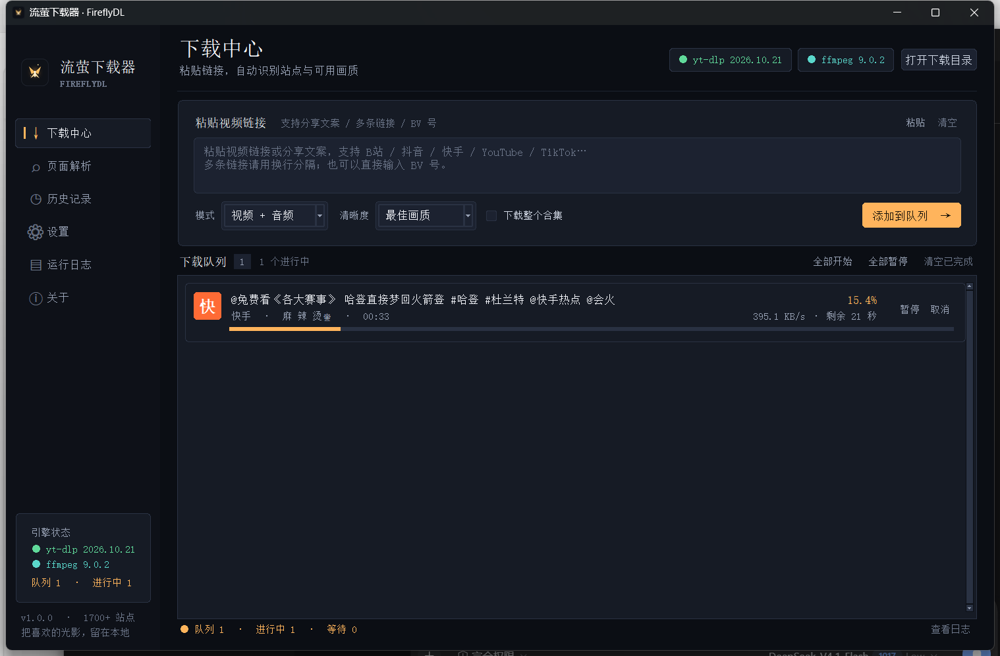
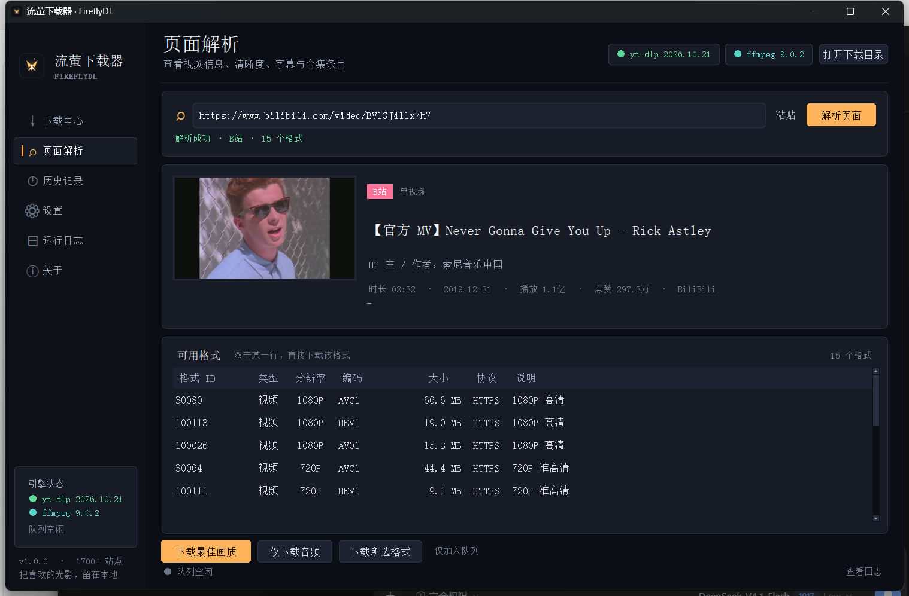
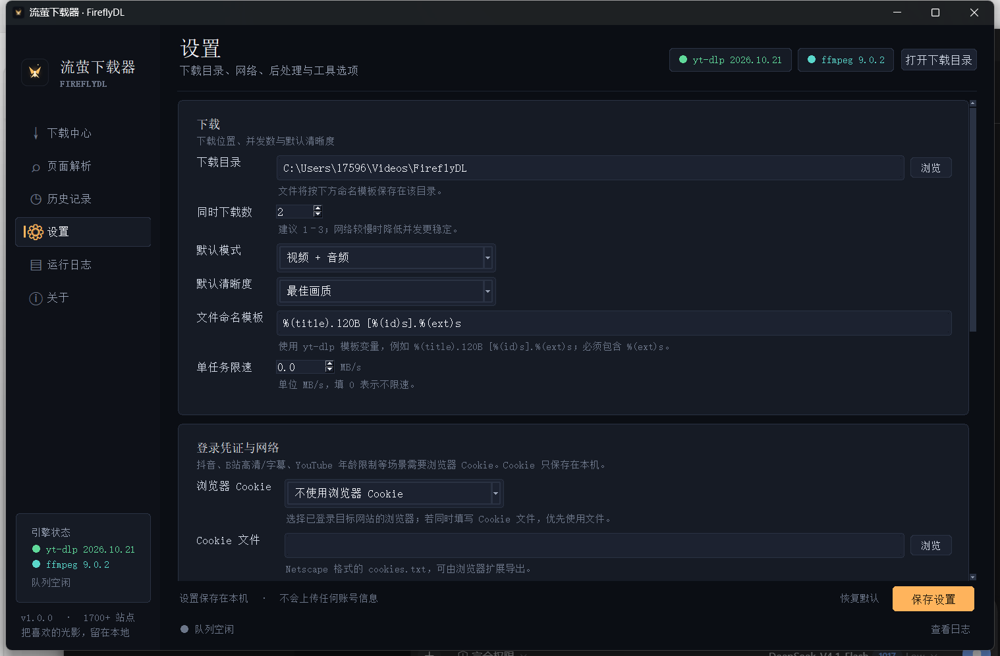

# 流萤 FireflyDL

> 多站点视频下载与页面解析工具 · 桌面 GUI + 命令行双模式 · 完全本地运行

流萤以 [yt-dlp](https://github.com/yt-dlp/yt-dlp) 为内核，针对中文站点补上了快手分享页解析，并把「粘贴链接 → 解析 → 选清晰度 → 排队下载」做成了一个深色桌面界面。B 站、抖音、快手、YouTube、TikTok、微博、小红书、X、Instagram 等 1700+ 站点都可以通过同一个入口处理。



## 功能

- **图形界面**：下载中心、页面解析、历史记录、设置、运行日志、关于，六个页面各司其职。
- **高 DPI 与字体**：启动时启用 Per-Monitor DPI 适配，优先使用 Noto Sans SC，圆角卡片 / 任务卡 / 按钮与柔和字重，125% / 150% 缩放下不再发虚。
- **命令行模式**：适合脚本、批处理与自动化；支持 `--info`、`--json`、`-f`、`--audio`、代理、Cookie 等参数。
- **页面解析**：读取标题、作者、封面、简介、播放量、字幕语言，列出全部可用格式；双击一行即可按该格式下载。
- **多站点支持**：B 站、抖音、快手、YouTube、TikTok、微博、小红书、X、Instagram、Vimeo、Twitch、AcFun、爱奇艺、腾讯视频、优酷、芒果 TV 等。
- **内置快手扩展**：yt-dlp 上游目前没有稳定的快手提取器，项目内置 `KuaishouFireflyIE`，解析快手移动分享页中的 HLS / 直链。
- **下载队列**：多任务并发、暂停、继续、取消、重试、失败提示；保留 `.part` 分片，恢复网络后可继续。
- **画质与格式**：最佳画质、4K/2K/1080P/720P/480P/360P、仅音频 MP3、任意 yt-dlp format selector。
- **后处理**：合并音视频、嵌入封面、写入元数据、下载字幕、嵌入字幕、文件命名模板。
- **登录与网络**：浏览器 Cookie（Chrome/Edge/Firefox/Brave 等）、cookies.txt、HTTP/SOCKS 代理、限速、重试。
- **本地数据**：设置、历史、日志保存在 `%APPDATA%\FireflyDL`，不上传账号信息。

## 环境要求

| 项目 | 要求 |
|---|---|
| 系统 | Windows 10/11（主要测试环境），macOS / Linux 也可运行 |
| Python | 3.10 或更高，安装时勾选 **Add Python to PATH** |
| 依赖 | `yt-dlp`、`Pillow`、`mutagen`（`install.bat` 会自动安装） |
| ffmpeg | 推荐安装，用于音视频合并、MP3 转换；`C:\ffmpeg\bin\ffmpeg.exe` 或 PATH 中任意位置 |
| 磁盘 | 下载目录预留足够空间 |

> 当前 Python 3.10 会触发 yt-dlp 的弃用提示，不影响运行；如果方便，建议使用 Python 3.11/3.12。

## 快速开始

### 方式一：一键安装（Windows）

```bat
:: 在项目目录双击，或在命令行运行
install.bat
```

脚本会创建 `.venv` 虚拟环境、安装依赖并检查 ffmpeg。完成后：

- 双击 **`start_gui.bat`** 打开图形界面。
- 双击 **`start_cli.bat`** 打开命令行并显示帮助。

### 方式二：手动安装

```bat
cd FireflyDL
python -m venv .venv
.venv\Scripts\activate
pip install -r requirements.txt
python app.py
```

不使用虚拟环境也可以：

```bat
pip install -U yt-dlp Pillow mutagen
python app.py
```

### 启动 GUI

```bat
python app.py
```

### 直接运行已打包的 EXE

如果不想配置 Python，可以直接使用项目中已构建好的 Windows 版本：

```text
dist\FireflyDL\FireflyDL.exe          # 图形界面
dist\FireflyDL-CLI\FireflyDL-CLI.exe  # 命令行
```

EXE 目录需要保持完整（尤其是 `_internal` 文件夹）。ffmpeg 不随包内置，仍建议安装到 PATH 或在设置中指定。

### 启动 CLI

```bat
python cli.py --help
python cli.py "https://www.bilibili.com/video/BV1GJ411x7h7" -q 1080
```

## 图形界面

### 下载中心

- 粘贴单条或多条链接，或直接粘贴分享文案（自动提取 URL，也识别 BV/av 号）。
- 选择模式、清晰度、是否下载整个合集，点击「添加到队列」。
- 任务卡上可暂停、取消、继续、重试、打开文件；支持全部暂停 / 全部开始。
- 下载完成后可自动在资源管理器中定位文件（设置中开启）。

### 页面解析



- 查看封面、标题、UP 主、时长、播放/点赞和简介。
- 格式表列出格式 ID、类型、分辨率、编码、大小、协议和说明。
- 双击格式行即可按该格式下载；也可以选择「仅下载音频」或「下载最佳画质」。
- 合集 URL 会显示条目列表，双击单条可继续解析，底部按钮可整包下载。

### 历史与设置



- 历史记录支持打开文件、打开所在目录、重新下载、删除单条、清空全部。
- 设置中可修改下载目录、并发数、默认模式/清晰度、命名模板、限速、Cookie、代理、字幕/封面/元数据等。
- 内置「更新 yt-dlp」按钮，更新后重启应用生效。

## 命令行

```bat
:: 基本信息与格式
python cli.py "URL" --info
python cli.py "URL" --json

:: 下载
python cli.py "URL" -q 1080
python cli.py "URL1" "URL2" -o "D:\Videos\收藏"
python cli.py "URL" --audio
python cli.py "URL" -f "137+140"

:: 合集 / 播放列表
python cli.py "PLAYLIST_URL" --playlist --playlist-limit 20

:: 需要登录的站点
python cli.py "URL" --cookies-from-browser edge
python cli.py "URL" --cookies "D:\cookies.txt"

:: 网络
python cli.py "URL" --proxy http://127.0.0.1:7890

:: 交互模式
python cli.py --interactive
```

常用参数：

| 参数 | 说明 |
|---|---|
| `-q, --quality` | `best` / `2160` / `1440` / `1080` / `720` / `480` / `360` |
| `-f, --format` | 自定义 yt-dlp format selector，例如 `137+140` |
| `-a, --audio` | 仅音频，使用 ffmpeg 转 MP3 |
| `-o, --output` | 下载目录 |
| `--info` / `--formats` | 只解析并显示信息、格式表 |
| `--json` | 以 JSON 输出解析结果，适合二次处理 |
| `--playlist` / `--no-playlist` | 是否下载整个合集 |
| `--cookies-from-browser` | `chrome`、`edge`、`firefox`、`brave` 等 |
| `--cookies` | Netscape 格式 cookies.txt |
| `--proxy` | HTTP / HTTPS / SOCKS 代理 |
| `--concurrency` | CLI 并发任务数，默认 1 |
| `--subs` / `--no-subs` | 字幕开关 |
| `--update` | 更新 yt-dlp |
| `--gui` | 从 CLI 入口启动 GUI |

`python app.py --cli` 与 `python cli.py` 等价；`python -m fireflydl` 也可以运行 CLI。

## 各站点说明

### B 站

- 不登录可下载公开视频的常规清晰度；1080P 高码率、部分字幕需要登录 Cookie。
- 设置 → 登录凭证 → 浏览器 Cookie 选择 Chrome/Edge，或传入 cookies.txt。
- 支持普通视频、番剧、课程、合集、收藏夹、UP 主空间等 yt-dlp 已支持页面。

### 抖音

抖音网页接口有风控，**需要新鲜 Cookie**（不一定要登录账号，但必须是最近访问过抖音的浏览器 Cookie）。

1. 用 Edge/Chrome 打开 `https://www.douyin.com/` 随便浏览一下；
2. 在流萤「设置 → 登录凭证 → 浏览器 Cookie」选择对应浏览器；
3. 重新解析或下载。

如果浏览器正在运行导致读取 Cookie 失败，可先关闭浏览器，或用扩展导出 `cookies.txt` 后选择文件。

### 快手

- 内置扩展直接解析移动分享页，公开分享链接通常无需 Cookie。
- 支持 `kuaishou.com/short-video/...`、`v.kuaishou.com/...`、`m.gifshow.com/fw/photo/...`、`chenzhongtech.com/...`。
- 如果页面要求人机验证，可在设置中导入浏览器 Cookie；站点改版导致失效时，更新 yt-dlp 或项目扩展。

### YouTube

- 国内网络通常需要代理：设置 → 代理地址填入 `http://127.0.0.1:7890` 一类地址。
- 年龄限制、会员视频可能需要登录 Cookie；无法绕过付费墙或 DRM。

### 其他站点

- 微博、小红书、X、Instagram 等可能需要 Cookie 才能查看敏感内容。
- 所有站点最终是否可下载取决于 yt-dlp 的提取器与站点当前策略；遇到 `Unsupported URL` 时优先更新 yt-dlp。

## 目录结构

```text
FireflyDL/
├─ app.py                      # GUI / CLI 启动入口
├─ cli.py                      # CLI 快捷入口
├─ install.bat                 # 一键创建虚拟环境并安装依赖
├─ start_gui.bat               # 双击启动 GUI
├─ start_cli.bat               # 双击启动 CLI
├─ build_exe.ps1               # PyInstaller 打包脚本
├─ requirements.txt
├─ assets/
│  └─ firefly.ico / .png
├─ fireflydl/
│  ├─ config.py                # 设置
│  ├─ models.py                # 任务 / 媒体信息模型
│  ├─ manager.py               # 下载队列调度
│  ├─ service.py               # yt-dlp 封装
│  ├─ utils.py                 # URL / 格式化 / 错误提示工具
│  ├─ history.py               # 历史记录
│  ├─ cli.py                   # 命令行实现
│  └─ gui/                     # Tkinter 界面
├─ yt_dlp_plugins/
│  └─ extractor/kuaishou.py    # 快手 yt-dlp 扩展
├─ tests/                      # 单元测试
└─ docs/screenshots/
```

## 数据与隐私

- 设置：`%APPDATA%\FireflyDL\settings.json`
- 历史：`%APPDATA%\FireflyDL\history.json`
- 日志：`%APPDATA%\FireflyDL\fireflydl.log`
- yt-dlp 缓存：`%APPDATA%\FireflyDL\cache`
- Cookie 只用于本机请求目标站点，不会上传到任何第三方服务器。
- 项目不包含统计、遥测或远程 API。

## 打包为 EXE（可选）

```powershell
powershell -ExecutionPolicy Bypass -File .\build_exe.ps1
```

输出：

- `dist\FireflyDL\FireflyDL.exe`：GUI
- `dist\FireflyDL-CLI\FireflyDL-CLI.exe`：命令行

打包使用 PyInstaller，体积较大（内置 yt-dlp 全部提取器），首次启动会慢几秒。未签名的 EXE 可能触发 SmartScreen，属于正常现象。

## 测试

```bat
python -m unittest discover -s tests -v
```

覆盖 URL 提取、站点识别、设置、任务状态、历史持久化、format selector、媒体信息归一化和快手扩展 URL 匹配。真实下载受网络与站点策略影响，不作为单元测试的一部分。

## 常见问题

**提示 yt-dlp 未安装**

```bat
python -m pip install -U yt-dlp Pillow mutagen
```

**没有声音 / 无法合并音视频 / MP3 转换失败**

安装 ffmpeg，确保 `ffmpeg.exe` 在 PATH，或在「设置 → 工具与维护 → ffmpeg 路径」指定。流萤会同时检查同目录下的 ffprobe；没有 ffprobe 时会尽量用 mutagen 嵌入封面。

**YouTube 超时**

配置代理，或在命令行加 `--proxy`。也可以用 `--cookies-from-browser` 解决登录/风控问题。

**抖音提示需要 Cookie**

按上文「抖音」步骤导入浏览器 Cookie。只访问过抖音但不登录，也可能获得可用的游客 Cookie。

**快手解析失败**

先更新 yt-dlp，并确认项目根目录存在 `yt_dlp_plugins`。快手改版时可能需要更新 `kuaishou.py`；如果页面要求验证，请导入 Cookie。

**下载后文件名乱码 / 太长**

设置中使用 `%(title).120B [%(id)s].%(ext)s` 模板（默认），`windowsfilenames` 会自动清理非法字符。

**断点续传报 HTTP 416 / Requested Range Not Satisfiable**

应用会检测到这种情况，自动清理失效的 `.part` 分片并从头重试一次。如果仍失败，到下载目录删除同名 `.part` 文件后重新下载即可；已经完整下载的视频文件不会受影响。

**GUI 打不开 / 没有图形环境**

使用命令行：

```bat
python cli.py "URL" --info
```

## 免责声明

本工具仅用于下载你有权访问、拥有版权或已获授权的内容，以及个人学习、备份用途。请遵守各站点用户协议、著作权法与当地法律。项目不绕过付费墙、DRM 或访问控制，不提供内容分发服务。

## 致谢

- [yt-dlp](https://github.com/yt-dlp/yt-dlp)：核心提取与下载能力
- [Pillow](https://python-pillow.org/)：界面封面处理
- [mutagen](https://mutagen.readthedocs.io/)：封面/元数据嵌入
- Tkinter：桌面界面
